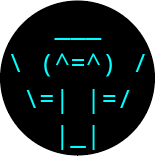
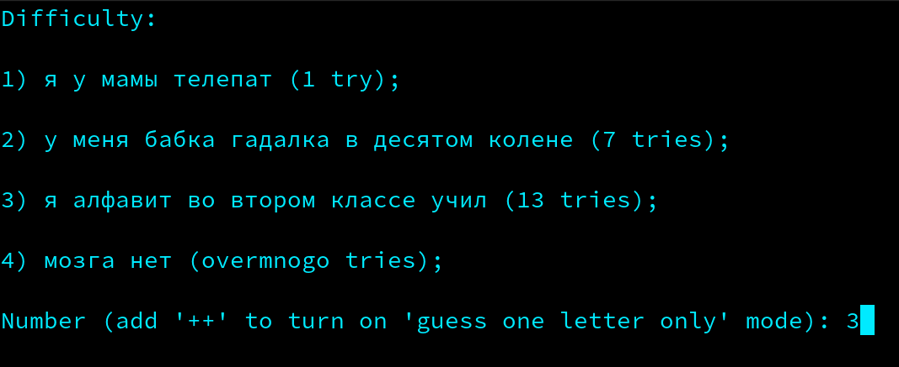
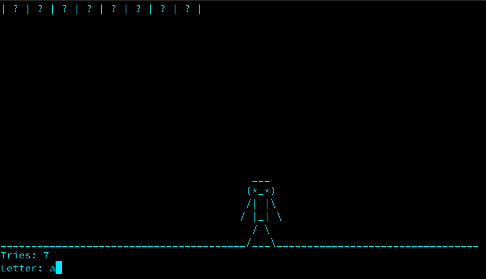
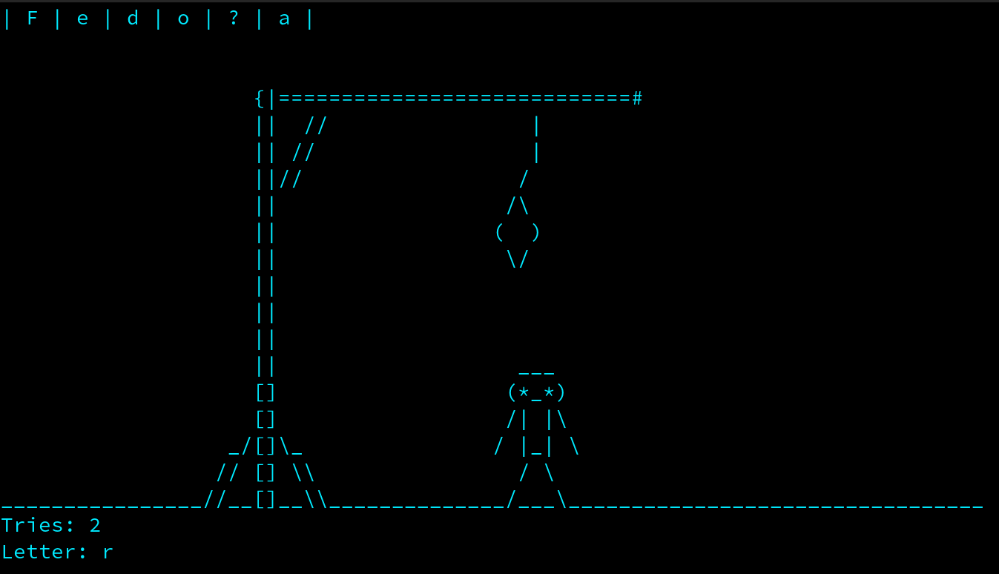
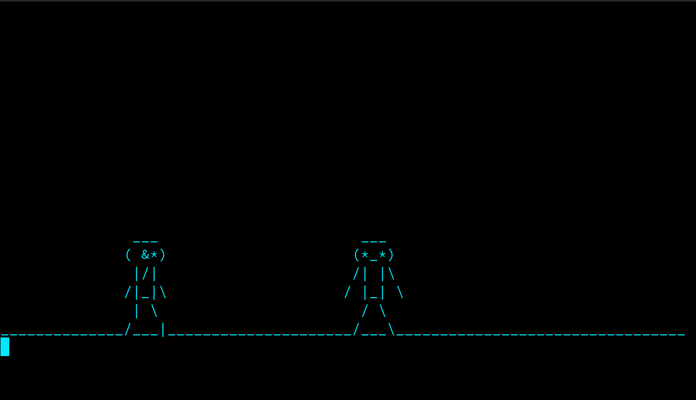
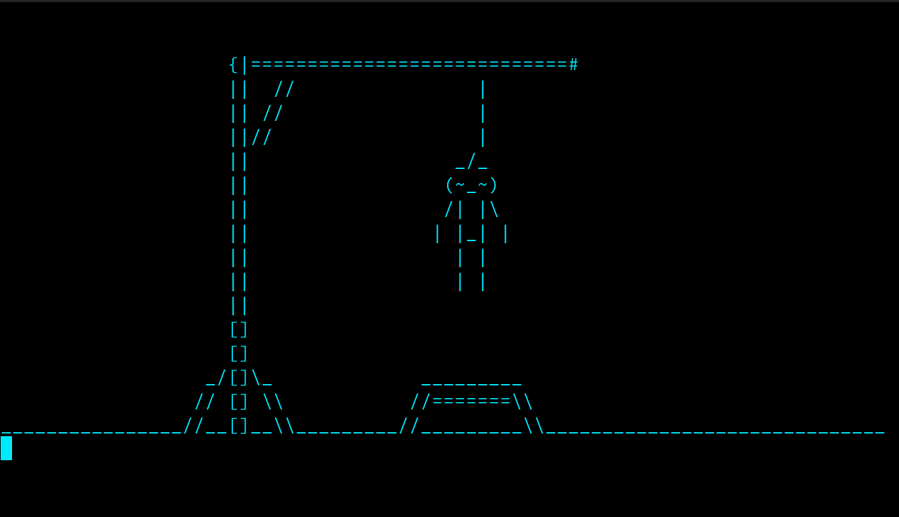
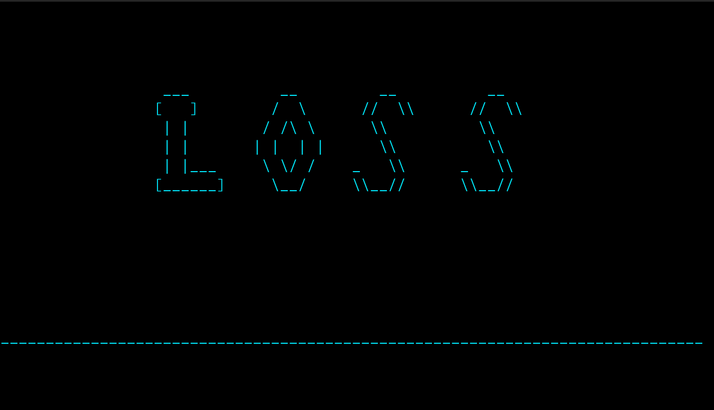
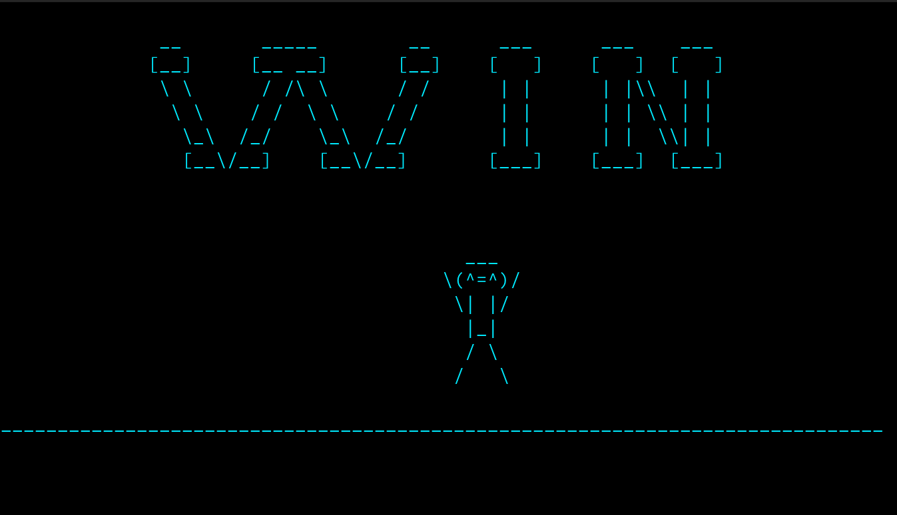

# Gallows (Hangman) game application

<p align="center">
  <a href="https://andrew1407.github.io/gallows-remastered/">
    
  </a>
</p>

[](https://github.com/andrew1407/gallows-remastered/actions/workflows/tests.yml)
[](https://github.com/andrew1407/gallows-remastered/actions/workflows/pages.yml)

## Description

This project contains multiple implementation handling Hangman game logic. There's an offline **[console app](./index.js)** version which can be simply run using console command. An [online](./server/) app version is available as well: to use it, firstly run a **[server](./server/index.js)** script and then launch a **client** one. They used one of defined connection strategies (**[dataraw](./server/strategies/dataraw/), [streamable](./server/strategies/streamable/)**) and connection types (**HTTP, WS, UDP and TCP**) defined in a config (**[here's](./server/env.example.json)** example) - **env.json**. Besides the mentioned options, the config also contains connection address (host & port). The client can be used as both [console](./server/client.js) and [browser](./server/public/) apps.

The [browser](./server/public/) page has two versions picked by the `version` query param (try them on **[GitHub Pages](https://andrew1407.github.io/gallows-remastered/)**):

+ `?version=0` (default) - the **[ASCII](./server/public/ascii/)** client, as it is in the console: it connects to the server with the configured strategy (HTTP or WS) and falls back to a **local** mode (the [dataraw](./server/strategies/dataraw/) service running in the page with an in-memory db) when there's no server;
+ `?version=1` - the **[2D sprites](./server/public/sprites/)** version rendered with **WebGPU** (**WebGL2**, then **Canvas 2D** fallback): **offline** mode or online mode with a [dataraw](./server/strategies/dataraw/) server address - `http://host:port` or `ws://host:port/dataraw`.

The whole page is also built (with **vite**) into a single self-contained `dist/index.html` which can be opened straight from disk.

## Commands

To run offline console app:
```bash
npm run console
```

To run server app:
```bash
npm run server
```

To run online client app:
```bash
npm run client
```

To run tests (**node:test**, 100% line and function coverage gate, Node.js 26):
```bash
npm test
```

To build the single-file browser page (`dist/index.html`):
```bash
npm run build
```

## Gameplay

Choose difficulty:



Main gameplay (wordguessing):





Loss cases:







Win case (guess a word):


